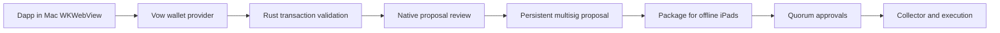

# RFD 0002: Build multisig proposals through a Mac dapp browser

State: discussion
Authors: Vow project · Started: 2026-11-09

## Problem

The native apps currently exchange non-executable sample files. We need a way to
construct actual project transactions without putting treasury approval keys on
the connected Mac. The owner proposed a WKWebView navigator that intercepts the
handoff to a browser wallet.

Navigation interception alone cannot cover wallet requests. Wallet Standard
applications discover providers and invoke JavaScript methods. A transaction can
reach a wallet without any link navigation. The browser must provide an explicit
wallet bridge and a transaction-to-proposal compiler.

## Sketch

Use the connected Mac to browse, construct and submit proposals. Keep the iPad
signer offline and independent of web content. The proposed flow is:

The dapp supplies candidate instructions. Rust validates and normalizes them,
retaining the original bytes and an explicit transformation record. The Mac
creates an on-chain proposal, then verifies its stored action before exporting
an approval package. Offline iPads independently decode the proposed action.

Status is explicit: Captured draft, Proposal created, Awaiting approvals, Ready
to execute, Executed. A proposal-creation transaction signature is not evidence
that the requested transfer or trade has executed.

### Existing precedent

SquadsX documents a provider that exposes a vault PDA, turns dapp instructions into
a signed proposal-creation transaction, and leaves voting and execution for later.
Solana Wallet Standard explicitly permits modified signed transaction results for
multisig and meta-transaction wallets. This is a stronger starting point than a
provider that leaves a JavaScript promise open throughout the offline ceremony.

Sources and pinned revisions are in [RESEARCH](../RESEARCH.md#mac-dapp-browser-and-proposal-capture-2026-11-09).
The published SquadsX compatibility list is evidence that a compatibility matrix
is needed, not evidence that every dapp works with Vow.

### Wallet surface

| Request | Proposed behavior |
|---|---|
| Connect | Native permission prompt binds the requesting HTTPS origin to one organization, project, chain and vault address. Expose the vault PDA, not the proposer or member key. |
| `solana:signTransaction` | In the proposal-capable phase, return a genuinely signed outer transaction that creates the reviewed proposal. The dapp broadcasts it. Verify landing before calling the proposal created. |
| `solana:signAndSendTransaction` | Create and submit the reviewed proposal, then return its real outer transaction signature. Keep proposal and eventual action execution distinct in native UI. Test the dapp's interpretation. |
| `solana:signMessage` / `solana:signIn` | Unsupported initially for the vault PDA. Do not substitute the Mac's signature or impersonate the vault. |
| Batches, extra signers and unsupported transaction versions | Explicit rejection until independently implemented and tested. Advertise only supported features and versions. |
| Wallet deep links | Handle as separate, explicit transports. Do not treat arbitrary navigation URLs as authenticated signing requests. |

A capture-only spike may save a draft and reject the original signing request with
an explicit explanation. It must not return fake signatures, claim signing success
or advertise production signing support. A custom proposal API can return a draft
ID, but that is separate from standard signing results.

Wrapping changes the transaction. Preserve instruction meaning, account privileges
and project authority. Never silently remove existing signatures or assume they
can be copied to the wrapper. Initially reject extra required signers, unresolved
lookup tables, unknown instructions and transaction-introspection dependencies.
Handle compute-budget and fee instructions deliberately rather than blindly
copying or discarding them. Keep any normalization visible and hash the actual
stored inner action, not just the original browser transaction.

### Native WebKit adapter

A small browser supplies back, forward, reload, an editable URL, visible origin,
and persistent native project/vault context. Web content never draws the trusted
approval UI. A project switch or committed navigation invalidates prior browser
permissions and outstanding requests.

Inject a bundled Vow provider with `WKUserScript` and Wallet Standard registration
at document start. Use a thin, bounded JavaScript transport and
`WKScriptMessageHandlerWithReply` for native responses. The provider is an adapter,
not a place for canonical parsing, policy checks or approval state.

Apple also supports explicitly hosting web extensions with
`WKWebExtensionController` from macOS 15.4. A WKWebView does not automatically
inherit the user's installed browser wallets. Hosting a full extension adds
permission, tab and lifecycle responsibilities. Start with our own small provider;
revisit extension hosting only for demonstrated compatibility requirements.

Treat the page world as hostile even if our injected provider is frozen. Native
checks use WebKit's frame, security origin, top-level document and navigation
generation. An `origin` field supplied by JavaScript is never authoritative.
Isolated content worlds can separate implementation state but do not authenticate
page requests or turn page-provided transaction bytes into trusted data.

Initial boundaries:

- HTTPS top-level frames only, with explicit per-origin native connection grants.
- No blanket bridge access for subframes, redirects, popups or external schemes.
  New tabs/windows must be assigned a native project context and fresh permission.
- Project-scoped website data and a clear reset/disconnect action.
- Bounded message lengths, request counts and pending lifetimes. One native review
  at a time. Reject stale, duplicate or cross-project replies.
- No native file access, shell execution, arbitrary RPC proxy, key access, generic
  signing or policy mutation callable through the JavaScript bridge.
- Page-supplied titles, logos, decoded summaries and simulation claims stay
  untrusted. Rust decodes bytes and the iPad repeats that work independently.

### Rust ownership

A portable proposal engine should accept bounded transaction bytes and explicit
native context. It should own:

- Parsing and supported transaction-version negotiation.
- Organization/project/quorum policy binding and chain/vault address checks.
- Instruction decoding, allowed operations and extra-signer rejection.
- Required account-context enumeration, deterministic review and action digest.
- Compilation to the selected multisig proposal representation.
- Comparison of the submitted and fetched proposal action with the reviewed draft.
- Approval package generation and later evidence validation.

Swift owns WebKit, origin observations, native prompts and platform key access.
RPC acquisition and submission use an explicit connected-Mac adapter. Prefer Rust
chain libraries for protocol logic. Keep any JavaScript compatibility bundle small,
pinned and free of private keys.

### Online proposer versus offline approval authority

A wrapped proposal can be submitted promptly using a separate online proposer and
fee-payer key. Squads v4 distinguishes Initiate, Vote and Execute permissions. The
candidate Mac role has Initiate only, no Vote permission, no configuration authority
and no treasury spending-limit authority. Its key cannot replace an offline quorum
approval. Rent and transaction fees still need limits.

This is a proposed least-privilege configuration, not a property of the current
prototype. Validate its exact deployed authority graph, including configuration
and recovery paths, before enabling real funds. An external proposer signer is an
alternative if we do not want a persistent online key in the Mac app.

Projects need real on-chain bindings: chain identity, program ID, multisig address,
vault index/address and the enrolled-member-to-on-chain-signer mapping. Reusing a
Vow quorum does not imply that all projects share one on-chain multisig account.
A safe default to evaluate is separate multisig instances per project using the
same enrolled member references. Separate vaults in a shared multisig are another
choice, with shared governance and upgrade consequences. Do not implement different
project thresholds as labels over one global Squads threshold.

### Offline lifetime remains a separate gate

Store the executable instructions in a persistent proposal before offline review.
Fresh outer fee-payer transactions can later submit votes and execute it. Do not
keep an ordinary recent-blockhash transaction alive across human approval delays,
or replace bytes after a member has signed them.

Persistent proposals do not remove program-level expiries, stale market quotes or
state dependencies. The P-256 bridge reviewed in this repo has an inner freshness
constraint. Browser capture and proposal creation do not solve that constraint or
prove that offline iPad approvals can vote through the selected bridge. Preserve
that end-to-end feasibility gate from [RFD 0001](0001-signing-and-enforcement.md).

## Open questions

- Which initial dapps and actions matter? Test one deterministic transfer fixture
  and one chosen public dapp before claiming general compatibility.
- Does each target dapp accept a returned proposal wrapper? Does it show a false
  executed state, poll the wrong signature, or depend on immediate state changes?
- Which actions survive offline approval latency? Begin with deterministic
  transfers; independently evaluate staking and other persistent actions. Trading
  quotes, deadlines, slippage and multi-step state changes need explicit limits.
- How do we provision proposer permission without giving the Mac a bypass? Prove
  the account permissions and all configuration/recovery authorities in local tests.
- How will project/quorum reuse map to multisig instances and vaults? Measure
  isolation, rent costs and the scope of membership/configuration changes.
- Can the chosen P-256 path authorize delayed votes and execution? Run the full
  stored-proposal flow after a delay beyond the reviewed bridge's freshness window.
- What account context can the iPad independently authenticate while offline?
  An RPC response or simulation result inside the package is not a chain proof.

## Risks

An embedded browser expands the Mac attack surface and allows phishing. Treat the
Mac as a proposer that may be compromised, so iPad validation remains authoritative.
A provider may capture an instruction perfectly and still produce an unsafe action.

A compatible wallet call is not proof of multisig compatibility, correct proposal
wrapping, offline validity or safe execution. Existing partial signatures, address
lookup tables, fee-payer differences and CPI-sensitive programs can break wrapping.
A dapp can also falsely imply completion after only proposal creation.

## Implementation sequence and acceptance gates

1. Native transfer construction and imported transaction bytes feed one Rust draft
   engine. Add pinned golden fixtures and rejection cases. No chain submission yet.
2. Add the Mac browser behind an experimental action. A controlled fixture discovers
   Vow, requests connection and sends bytes to native review. Prove origin/frame,
   navigation, project-switch, size-limit and cancellation behavior. Capture-only
   results are explicit and cannot authorize a real transfer.
3. Add proposal creation on a local validator with an Initiate-only test key. Verify
   that the stored action equals the native draft and the key cannot vote, execute
   or alter configuration. Exercise the standard modified-transaction return path.
4. Run a selected public dapp and document exact supported actions and failures.
   Reject unsupported login/message signing and dependency-bearing batches.
5. Export the confirmed proposal, obtain delayed iPad approvals and perform local
   end-to-end execution through the selected signing route. Reject action changes,
   wrong quorum/vault/chain, replay and expired authorization. This step is blocked
   until the P-256 voting and lifetime questions are solved.
6. Review the bridge, supply chain and on-chain authority graph before a low-value
   pilot. Browser functionality alone never advances production-readiness status.

## What we learned

2026-11-09: Apple APIs support both direct JavaScript/native request handling and
explicit web-extension hosting. Wallet Standard supports meta-transaction output,
and SquadsX documents the relevant wrapping approach. These are source findings;
Vow has not yet implemented or tested dapp transaction capture or real proposal
submission. No native application or prototype wire format changed for this RFD.

2026-11-09 follow-up: A capture-only Wallet Standard provider, explicit native
origin permission and multi-step transfer preparation are now implemented. The
local playground profiles a synthetic transfer through embedded Surfpool, exports
pre-state, independently reproduces and shares a `.vow` file. No signing result is
fabricated. Payment Channels byte inspection, plain dump import and optional
blockhash context are a separate read-only path. See [RFD 0003](0003-guard-and-reproduction.md)
for findings that prevent decorative pre-instructions from being treated as
attestation enforcement. Real Squads proposal creation and execution remain open.
